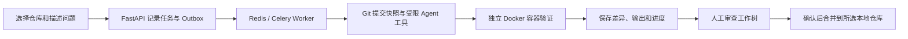

# CodeAgent

面向**本机可信 Python Git 仓库**的 AI 代码修复工作台。选择仓库、描述问题并指定验证方式后，CodeAgent 在独立快照中生成候选修复，运行检查，展示代码差异；只有人工审核并确认合并，所选本地仓库的分支才会改变。


## 能做什么

- 从已提交的 Git 版本创建任务快照。Agent 只能读取允许的 Python 源文件和所选测试，只能修改已有源文件，不能改测试或执行任意 Shell 命令。
- 用已有 `pytest`、直接运行 Python 脚本，或人工验证三种方式检查候选修改；保存修复前后的输出和状态。
- 通过页面查看任务进度、逐行代码差异及原文件行号、验证结果和执行记录。
- 将通过检查的修改放入独立 Git 审查工作树；人工确认后，才快进合并到任务选择的 `local_repos/<仓库名>`。
- 使用数据库 Outbox、Celery Worker 和 Beat 处理任务投递、重试与恢复；任务和进度事件持久化，页面通过 SSE 接收更新。


截图来自本地试验记录。新克隆的仓库不会附带任务数据库、密钥或试验仓库。

## 一次修复如何运行



Agent 通过 Claude Agent SDK 调用 DeepSeek，使用受限的文件列表、读取、整文件写入和局部片段替换工具。验证在无网络、无模型密钥的独立容器中进行。任务失败时保留原因和已有候选差异；通过测试也仍需人工检查改动范围。

| 验证方式 | 如何判断结果 |
| --- | --- |
| 已有 `pytest` | 选择 1～8 个已跟踪的测试文件；修复前先确认问题能复现，修复后所选测试全部通过才算验证通过。 |
| 直接运行 Python | 运行一个已跟踪的 `.py` 入口，可填写预期输出片段；只有明确的预期得到满足才能自动确认结果，单纯正常退出仍需人工判断逻辑。 |
| 人工验证 | 检查修改后的 Python 语法并展示差异；需要自行运行和判断修复是否正确。 |

## 案例

项目内的 `scripts/create_validation_demos.py` 可生成三个独立的入门仓库，分别覆盖算法、数值计算和 SVG 绘图：

| 仓库 | 原问题 | 验证方式 |
| --- | --- | --- |
| `demo_algorithm` | 二分查找漏掉最后一个候选位置，单元素及末尾元素查找失败。 | `pytest`：`tests/test_search.py` |
| `demo_numeric` | 位移累加公式错误，匀速运动 10 步应输出 `distance=5.00`。 | 直接运行 `src/simulate.py` 并核对输出 |
| `demo_plot_svg` | SVG 折线的纵坐标方向反了，预期点列为 `0,80 40,40 80,0`。 | 直接运行 `src/plot_svg.py` 并核对输出 |

随后使用**智能旅行助手的独立 Git 副本**测试了更复杂的问题：

| 真实仓库试验 | 修复前 | 候选修复与独立复核 |
| --- | --- | --- |
| POI 地图适配：成功结果被丢弃、上游异常被当成空结果 | 所选回归测试 3 项失败 | Agent 修改地图服务和路由；所选测试通过，相关测试 36 项及 42 个子测试通过。改动涉及更多功能，仍保留在审查工作树中。 |
| 日期一致性：非法日期、倒序日期、天数与日期跨度不符等 | 所选日期测试 5 项失败、1 项通过 | Agent 修改请求模型与行程校验；补充日期格式边界后，相关测试 41 项及 42 个子测试通过。 |

日期案例最初两次因 Agent 超时失败。排查后增加了受限的局部片段替换工具，使 Agent 能修改较大的源码文件；后续任务完成修复。这些失败记录保留，用于展示排查与迭代过程。完整的测试范围和限制见[真实仓库试验记录](docs/REAL_REPO_EVALUATION.md)。试验使用的是**副本**，CodeAgent 不会修改最初的旅行项目目录，也不能凭所选测试通过就断言所有外部服务行为正确。

另有 12 个固定 Bug 样例用于检查任务执行链路。首次完整评测为 **11/12**；失败项在调整工具提示后单独复测通过，原评测结果没有改写。该数字只反映这批固定样例，不能代表任意 Python 仓库的修复成功率。

## 技术栈

| 部分 | 技术与作用 |
| --- | --- |
| 页面与接口 | 原生 HTML、CSS、JavaScript；FastAPI；SSE 进度事件 |
| 任务与数据 | PostgreSQL、SQLAlchemy、Alembic；数据库 Outbox |
| 异步执行 | Redis、Celery Worker、Celery Beat |
| AI 修复 | Claude Agent SDK 接入 DeepSeek；受限的 MCP 文件工具 |
| 验证与审核 | Docker 隔离容器、`pytest`、Git 提交快照、审查工作树与快进合并 |
| 部署 | Docker Compose；Windows Docker Desktop + WSL 2 已联调 |

## 本地运行

需要 Docker Desktop（Windows 建议使用 WSL 2）、Git 和 DeepSeek API Key。生成示例仓库还需要本机 Python 3.10 或更高版本。以下命令在项目根目录用 PowerShell 运行：

```powershell
Copy-Item .env.example .env
```

编辑 `.env`，填入自己的 `DEEPSEEK_API_KEY`，并修改示例数据库密码。真实 `.env` 已被 Git 忽略，**不要提交密钥**。需要演示数据时运行：

```powershell
python scripts/create_validation_demos.py
```

任一同名目录已存在时，脚本会停止，不会覆盖原目录。启动服务：

```powershell
docker compose up --build
```

打开 [http://localhost:8000/](http://localhost:8000/) 并进入工作台。首次构建需要下载镜像和 Python 依赖；提交真实任务会调用 DeepSeek API 并产生费用。结束时在这个前台终端按 `Ctrl+C` 停止服务。接口文档位于 [http://localhost:8000/docs](http://localhost:8000/docs)。开发用的固定样例与 12 项评测默认不显示，可通过 `http://localhost:8000/?dev=1#workbench` 打开。

### 使用自己的仓库

将**整个已提交且工作区干净的 Python Git 仓库**（包含 `.git`）放到 `local_repos/<仓库名>`，回到工作台点击“刷新”。仓库名只用英文字母、数字、下划线和连字符。选择验证方式、填写问题后提交；在任务结果中检查差异与验证输出，再决定是否生成审查工作树并合并。

`local_repos` 中的仓库是任务实际作用的对象。如果它是从另一个项目复制来的副本，页面上的“合并到所选本地仓库”只修改这个副本。文件位置默认显示相对路径，可在“路径显示设置”中填写本机 CodeAgent 目录以查看完整路径。

## 运行边界

- 仓库快照限制为约 8 MB、500 个文件；只修改已有的、已跟踪的 Python 源文件。项目不会自动安装目标仓库依赖，复杂数值仿真或绘图项目需先满足验证容器的依赖和运行条件。
- 直接运行模式目前不提供图片或其他文件产物预览。没有明确预期输出时，程序正常退出不能证明计算或图形正确。
- 源码片段会发送给 DeepSeek 分析。服务无用户认证，只绑定本机回环地址；内部 Sandbox 服务持有 Docker socket，仅适合本人可信代码的本地学习和演示。
- `.env`、`local_repos/`、`reviews/`、运行数据和本机虚拟环境均不随 Git 仓库上传。

想按代码流程学习项目，可从[项目学习导图](docs/PROJECT_LEARNING_GUIDE.md)开始；阶段性设计与验证记录在 `docs/` 下。
