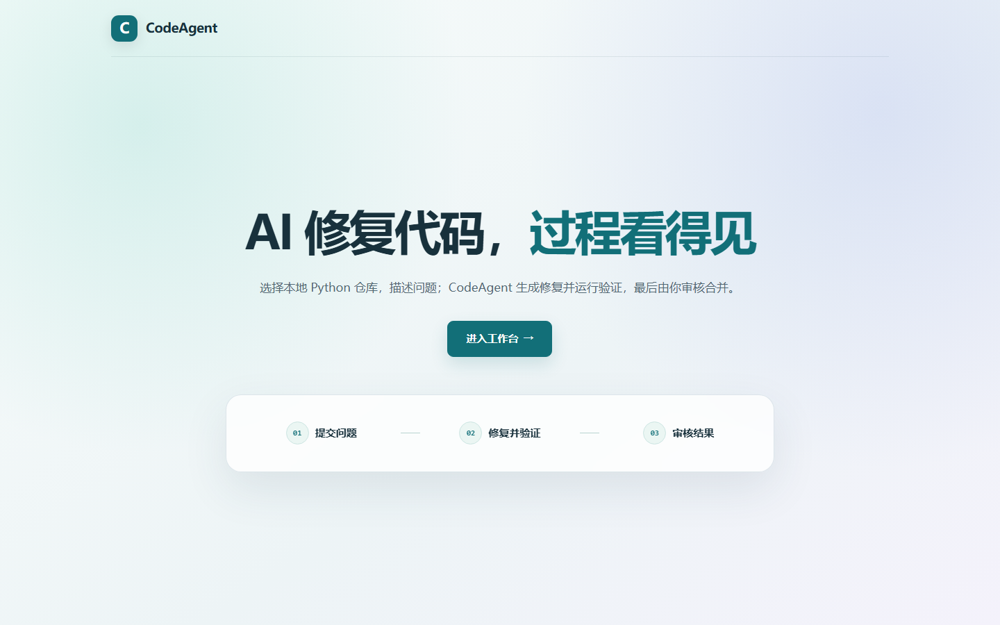
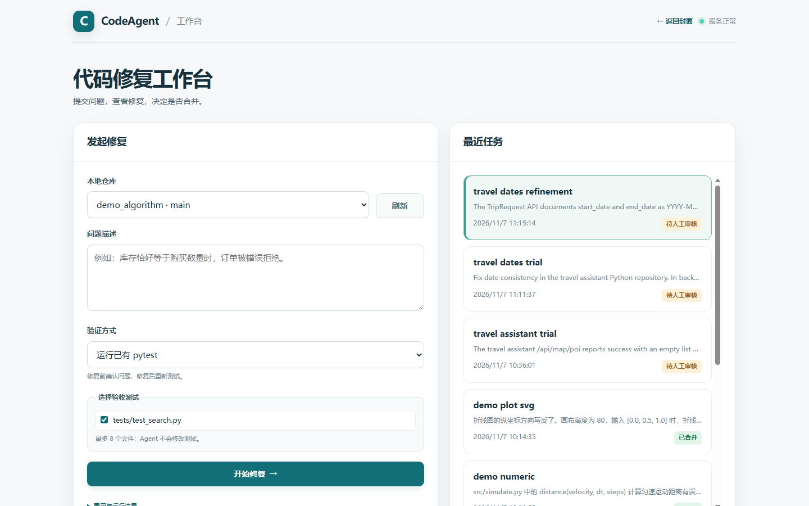
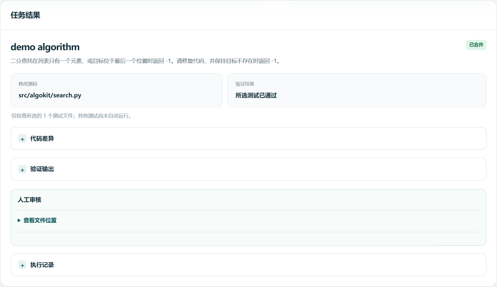
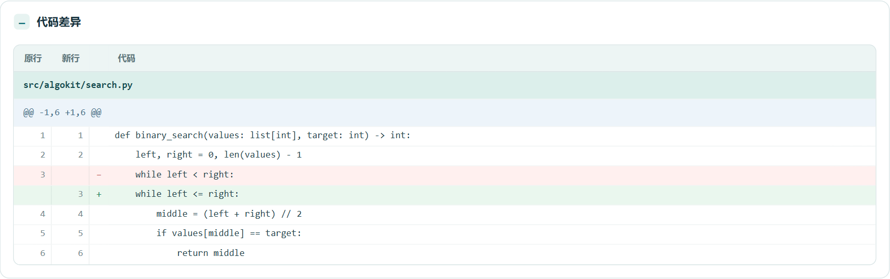
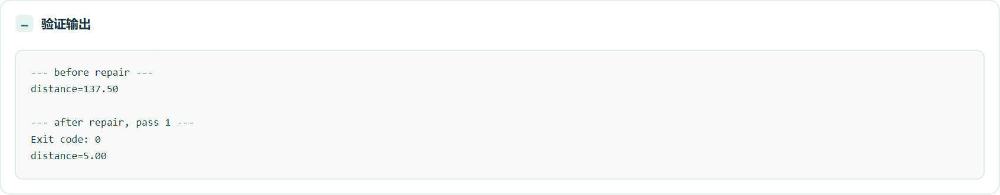
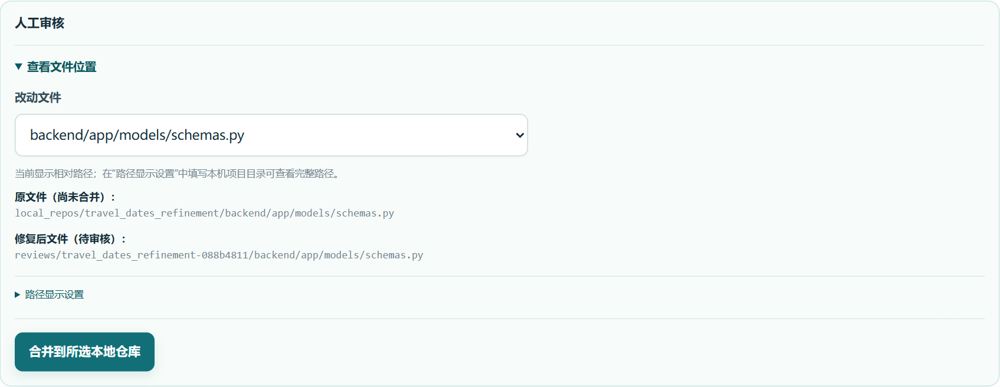
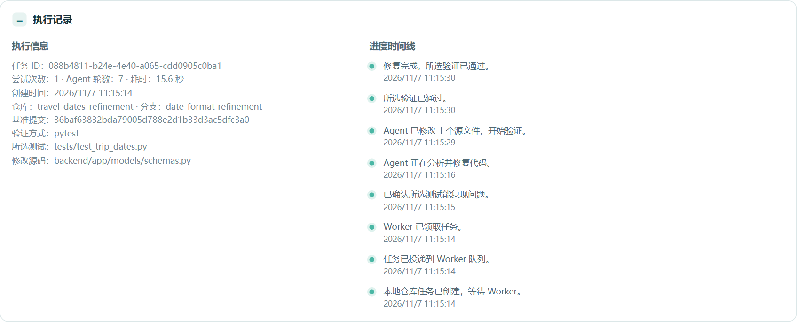
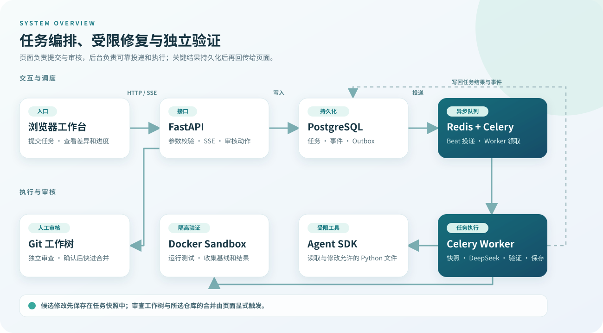

# CodeAgent

**把“描述问题 → AI 修改 → 隔离验证 → 人工审核”放进一个本地工作台。**

CodeAgent 面向本机可信的 Python Git 仓库。选择仓库、说明问题并指定验证方式后，它从当前提交创建独立快照，让 Agent 生成候选修复，保存代码差异和验证输出；你查看证据后，再决定是否把补丁合并到所选仓库。



[界面预览](#界面预览) · [快速开始](#快速开始) · [验证方式](#验证方式) · [架构设计](#架构设计) · [案例与验证记录](#案例与验证记录) · [运行边界](#运行边界)

## 项目亮点

- **从问题到补丁有完整记录**：固定 Git 基准提交，保存修复前检查、Agent 修改、修复后验证、任务状态和耗时。
- **修改范围可控**：Agent 通过受限文件工具读取所选测试与允许的源码，只能改已有、已跟踪的 Python 源文件；测试文件不会被改动。
- **验证方式可选择**：支持已有 `pytest`、直接运行 Python 文件并核对预期输出，以及人工验证。检查在独立的无网络 Docker 容器中运行。
- **合并由人决定**：工作台展示逐行差异、原文件行号和运行记录；候选修改先进入独立 Git 审查工作树，确认后才快进合并。
- **任务可追踪**：PostgreSQL Outbox、Redis、Celery Worker 和 Beat 处理投递与恢复，页面通过 SSE 获取持久化进度事件。

## 界面预览

封面和工作台是项目的两张主要界面图。下面先看完整工作台，再用较短的局部截图展示结果、验证与审核。截图来自本地试验任务；点击图片可打开原图。新克隆的仓库只包含展示素材，不包含本地任务数据。

### 1. 工作台总览

工作台左侧用于选择仓库、描述问题并设置验证方式；右侧列出最近任务。选择任务后，可以在下方查看结果和审核入口。

<p align="center"><a href="docs/images/workbench.png"></a></p>

### 2. 查看任务结果

任务页把修改文件、验证结论和审核入口集中展示。下图是已完成合并的算法示例；新任务的候选修复仍需先经过人工审核。

[](docs/images/result-summary.png)

### 3. 逐行检查修改

差异视图保留原行号和新行号。算法示例中，二分查找的循环条件从 `left < right` 改为 `left <= right`，覆盖只剩最后一个候选位置的情况。

[](docs/images/code-diff.png)

### 4. 对照修复前后输出

数值案例在修复前输出 `distance=137.50`；修复后运行同一入口，退出码为 0，输出变为预期的 `distance=5.00`。

[](docs/images/validation-output.png)

### 5. 审核工作树与执行记录

旅行日期案例的审核区域列出所选仓库中的原文件和审查工作树里的候选文件。完成代码和验证结果检查后，可由页面确认合并。

[](docs/images/review-panel.png)

同一旅行日期任务的执行记录保留任务 ID、基准提交、所选验证文件和各阶段时间线，便于回看一次修复如何完成。

[](docs/images/review-timeline.png)

## 快速开始

### 环境准备

- Docker Desktop 与 Docker Compose；Windows 环境建议启用 WSL 2。
- Git。
- DeepSeek API Key。提交真实修复任务会调用模型 API 并产生费用。
- 本机 Python 3.10+ 仅在运行示例仓库生成脚本时需要。

下面以 PowerShell 为例，首次使用先克隆项目并配置环境变量：

```powershell
git clone https://github.com/mulingxing/CodeAgent.git
Set-Location CodeAgent
Copy-Item .env.example .env
```

编辑 `.env`，填写 `DEEPSEEK_API_KEY`，并修改示例 `POSTGRES_PASSWORD`。该文件已被 Git 忽略。想先用三个小仓库体验流程，可在启动前运行：

```powershell
python scripts/create_validation_demos.py
```

脚本会在 `local_repos/` 中创建并提交 `demo_algorithm`、`demo_numeric`、`demo_plot_svg`。如果任一同名目录已经存在，脚本会停止，不会覆盖已有仓库。

启动全部服务：

```powershell
docker compose up --build
```

打开 [工作台](http://localhost:8000/)；接口文档位于 [http://localhost:8000/docs](http://localhost:8000/docs)。首次构建需要下载镜像和依赖。服务在当前终端前台运行，结束时按 `Ctrl+C`，再运行 `docker compose down` 停止并移除容器；数据库与 Redis 数据卷仍会保留。

### 用算法示例走完一次修复

1. 在工作台选择 `demo_algorithm · main`，验证方式选“运行已有 pytest”，勾选 `tests/test_search.py`。
2. 输入问题：`二分查找在列表只有一个元素，或目标位于最后一个位置时返回 -1。请修复代码，并保持目标不存在时返回 -1。`
3. 点击“开始修复”。CodeAgent 先运行所选测试确认问题，再让 Agent 修改源码，并重新运行所选测试。
4. 在“任务结果”中检查 `src/algokit/search.py` 的差异、修复前后输出和执行记录。
5. 点击“生成审查工作树”，检查候选文件；确认后再点击“合并到所选本地仓库”。

合并目标是页面选中的 `local_repos/<仓库名>`。生成审查工作树前，候选修改只存在于任务快照和结果记录中。

## 验证方式

| 模式 | 提交时选择 | CodeAgent 如何处理结果 |
| --- | --- | --- |
| 已有 `pytest` | 1～8 个已跟踪的 `tests/**/test_*.py` 文件 | 先运行所选测试确认能复现失败；修复后所选测试全部通过，才标记验证通过。 |
| 直接运行 Python | 一个已跟踪的 `.py` 入口，可填写运行参数和预期输出片段 | 记录修复前后输出。退出码为 0 且预期片段出现时可自动确认；未填写预期输出时，需要人工判断结果。 |
| 人工验证 | 问题描述 | 检查修改后的 Python 语法并展示差异；运行逻辑由你自行验证。 |

工作台支持取消任务。失败任务仍会保留失败原因，以及已经生成的候选差异和验证输出（如果有）。

## 使用自己的仓库

将**包含 `.git` 的完整 Python Git 仓库**放在 `local_repos/<仓库名>`，再到工作台点击“刷新”。提交前需要有已检出的分支、至少一个提交和干净的工作区。仓库名以英文字母或数字开头，后续可用英文字母、数字、下划线和连字符。

- `pytest` 模式的测试文件必须已跟踪，位于 `tests/` 下，文件名为 `test_*.py`。
- Agent 只编辑已跟踪的 Python 源码；如需验证复杂项目，先确认隔离容器具有目标仓库的依赖和可执行入口。
- 任务记录的是提交时的基准版本。如果仓库分支或提交在审核前改变，审查或合并会停止，避免把补丁应用到错误版本。
- 页面默认显示相对路径；在“路径显示设置”中填写本机 CodeAgent 项目目录，可查看完整文件路径。

## 架构设计

<p align="center"><a href="docs/images/architecture.svg"></a></p>

| 部分 | 职责 |
| --- | --- |
| FastAPI + 原生 HTML/CSS/JavaScript | 创建与查询任务，展示差异和验证记录，通过 SSE 更新进度，处理人工审核操作。 |
| PostgreSQL + Outbox | 持久化任务、结果和事件；任务创建与待投递消息在数据库中记录。 |
| Redis + Celery Beat/Worker | 将待执行任务投递到队列，领取任务，处理重试与恢复。 |
| Claude Agent SDK + DeepSeek | 在受限工具集内读取允许的文件并生成候选修复；大文件可用局部片段替换工具。 |
| Docker Sandbox | 在独立、无网络的容器中运行选定检查；验证容器不接收模型密钥。 |
| Git 快照 + 审查工作树 | 锚定基准提交，生成可查看的补丁；人工确认后对所选本地仓库执行快进合并。 |

代码入口可按 `src/codeagent/api.py` → `queue.py` / `tasks.py` → `repo_runner.py` → `sandbox.py` → `git_repos.py` 阅读。[项目学习导图](docs/PROJECT_LEARNING_GUIDE.md)列出了每一段流程对应的文件与问题。

## 案例与验证记录

### 三个可生成的入门仓库

| 示例仓库 | 原问题 | 验证 |
| --- | --- | --- |
| `demo_algorithm` | 二分查找漏掉最后一个候选位置。 | `pytest`：`tests/test_search.py` |
| `demo_numeric` | 匀速运动的距离累加公式错误。 | 直接运行 `src/simulate.py`，核对 `distance=5.00` |
| `demo_plot_svg` | SVG 折线纵坐标方向写反。 | 直接运行 `src/plot_svg.py`，核对点列 `0,80 40,40 80,0` |

### 真实 Python 仓库副本试验

在智能旅行助手的独立 Git 副本上，还做了两类多文件修复试验：

| 问题 | 修复前 | 候选修复与复核 |
| --- | --- | --- |
| POI 地图适配：成功结果被丢弃、上游异常被当作空结果 | 所选回归测试 3 项失败 | Agent 修改地图服务和路由；所选测试通过，后续相关测试 36 项及 42 个子测试通过。 |
| 日期一致性：非法日期、倒序日期、天数与日期跨度不符等 | 所选日期测试 5 项失败、1 项通过 | Agent 修改请求模型与行程校验；补充日期格式边界后，相关测试 41 项及 42 个子测试通过。 |

日期案例前两次因 Agent 超时未完成。加入受限的局部片段替换工具后，同一问题完成修复；历史失败记录保留在任务列表中。具体范围与过程见[真实仓库试验记录](docs/REAL_REPO_EVALUATION.md)。

项目还包含 12 个固定 Bug 样例，用于检查任务执行链路。首次完整评测为 **11/12**；失败样例在调整工具提示后单独复测通过，首轮记录没有改写。开发用样例和评测入口默认隐藏，可通过 `http://localhost:8000/?dev=1#workbench` 打开。启动评测会提交 12 个模型任务并产生 API 费用；更多指标定义见[阶段 4 记录](docs/STAGE4_PROGRESS_EVAL.md)。

## 项目结构

```text
src/codeagent/
  static/            工作台页面
  api.py             任务与审核接口
  queue.py           Outbox 投递
  tasks.py           Worker 任务执行
  repo_runner.py     仓库快照、Agent 修复与复验
  git_repos.py       仓库检查、审查工作树与合并
  sandbox.py         隔离验证调用
migrations/          数据库迁移
scripts/             示例仓库和本地检查脚本
tests/               项目自身测试
docs/                设计、试验记录和展示图片
```

本地开发可安装依赖并运行项目测试：

```powershell
python -m pip install -e ".[dev]"
python -m pytest -q
```

## 运行边界

- 面向本机可信仓库：服务只绑定 `127.0.0.1:8000`，当前页面没有用户认证；内部 Sandbox 服务持有 Docker socket。
- 单个仓库快照限制为 8 MB、500 个文件；可编辑的 Python 源文件须小于等于 100 KB。Agent 不执行任意 Shell 命令，也不能修改测试。
- 目标仓库的依赖不会自动安装；直接运行模式目前不预览生成的图片或其他文件产物。
- 发送给 DeepSeek 的内容可能包含所选源码片段。将私有仓库用于修复前，请确认其内容适合发送给所配置的模型服务。
- `.env`、`local_repos/`、`reviews/`、任务数据和本机虚拟环境均不随 Git 仓库提交。
