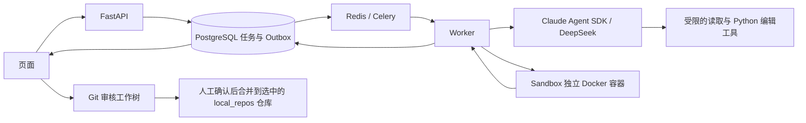

# CodeAgent 项目学习导图

## 一句话理解

这是一个面向**本机可信 Python Git 仓库**的 AI 代码修复工作台：提交问题后，后台 Agent 在受限文件范围内修改代码；隔离容器验证候选补丁；用户检查差异后决定是否合并。它的重点是任务编排、验证与人工审核，而不是实现一个通用编辑器。

## 主流程

仓库任务先从指定 Git 提交创建快照，运行所选验证以确认问题存在；Agent 只能修改已跟踪的 Python 源文件，不能修改测试。修复后重新验证，并保存差异、输出、耗时与状态。`pytest` 模式要求选中的测试从失败变为通过；直接运行模式可检查退出码和预期输出；人工模式只做语法检查，结果仍需人判断。

## 推荐阅读顺序

| 顺序 | 文件 | 重点问题 |
| --- | --- | --- |
| 1 | `src/codeagent/main.py`、`api.py`、`schemas.py` | 页面和 API 如何创建、查询、取消任务？输入在哪里校验？ |
| 2 | `models.py`、`database.py`、`migrations/` | 哪些状态与结果持久化？数据库表如何演进？ |
| 3 | `queue.py`、`celery_app.py`、`tasks.py` | Outbox 如何投递任务？Worker 如何幂等领取、超时重试和回收？ |
| 4 | `git_repos.py`、`repo_runner.py`、`runner.py` | 如何固定基准提交、限制可编辑文件、调用 Agent 并生成补丁？大文件为何使用局部替换？ |
| 5 | `sandbox_api.py`、`sandbox.py` | 为什么在独立、无网络、只读挂载的容器里验证？资源限制在哪里？ |
| 6 | `progress.py`、`evaluations.py`、`static/` | 进度如何传到页面？12 个固定样例的评测与真实仓库任务有什么区别？ |

建议每读完一段，就在页面上找对应状态：`queued`、`running`、`succeeded/failed`、生成审查工作树、人工合并。`tests/` 中的同名模块可用来核对边界和失败路径。

## 动手复现

1. 在项目根目录运行 `docker compose up --build`，保持这个终端打开；浏览器访问 `http://localhost:8000/`。
2. 先用 `demo_shop` 或 `demo_algorithm` 看一次“基线失败 → Agent 修改 → 验证通过 → 审核差异”的流程。
3. 查看 `local_repos/<仓库名>` 与 `reviews/<仓库名>-<任务 ID 前八位>`：前者是任务选中的独立 Git 仓库，后者是候选修复工作树。审核前的成功任务不会自动修改前者。
4. 完成后在前台 Docker 终端按 `Ctrl+C`。本地代码测试可运行 `.\.venv\Scripts\python.exe -m pytest -q`。

从其他项目复制来的试验仓库即使位于 `local_repos`，也仍是**副本**。页面“合并到原仓库”只影响这个被选中的副本，不会回写最初的项目目录。真实项目中的修复应先审查，再单独决定是否应用。

## 当前边界

- 支持已提交、干净的本地 Python 仓库；仓库依赖不会自动安装。数值计算、绘图等任务能否验证，取决于隔离容器是否具备依赖，以及是否有可执行的检查标准。
- 无认证，页面仅供本机使用。Sandbox 服务持有 Docker socket；只适合本人可信仓库的本地学习环境。
- 直接运行模式目前不提供图片或其他文件产物预览；程序正常退出也不等于逻辑正确。
- Agent 与模型调用可能超时或给出过宽的修改。测试通过后仍要检查差异范围，尤其是改动了多个功能时。

读完后，尝试不用看代码解释：为什么先做基线验证、为什么不能让 Agent 改测试、为什么生成审查工作树、为什么前台启动时 `Ctrl+C` 可以停止服务。能讲清这四点，就抓住了项目主线。
